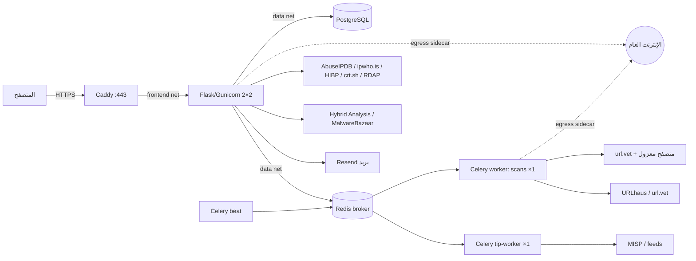

# MyScanner — مراجعة شاملة وخطة ما قبل الإطلاق (المرحلة الأولى)

- **تاريخ المراجعة:** 11 أكتوبر 2026
- **نسخة الأساس:** `main` عند `3c1ec4da153b605e9b57e333ce603878669ff2c7` (دمج PR #58 و#59)
- **بيئة المراجعة:** حاوية Linux (kernel 6.18)، Python 3.13.16، Node.js 22.22، SQLite محلي للتشغيل البصري، Chromium عبر Playwright. صورة VPS المقترحة تستخدم Python 3.11 وPostgreSQL 18 وRedis 7.4 وCaddy 2، ولم تُشغَّل هنا.
- **فرع التعديلات:** `claude/optimistic-planck-vm9rlq`

> هذه مراجعة كود وتشغيل محلي مع إعادة إنتاج مثبتة لبعض المشكلات. ليست اختبار اختراق على بيئة الإنتاج، ولا تدقيقًا مستقلًا معتمدًا، ولا ضمانًا بأن جميع المسارات آمنة. ما لم يُختبر مذكور صراحةً في القسم 11.

## تحديث التقدم: الخطوة 1 من خطة الإطلاق (11 أكتوبر 2026)

قرارات صاحب المشروع: (1) لا حكم «malicious» دون تأكيد من مصدر سمعة؛ (2) Sandbox وفحص الثغرات وTIP تبقى ظاهرة بوسم «قريبًا»؛ (3) حذف الادعاءات غير المثبتة؛ (4) الجمهور: أفراد وشركات صغيرة، عرب وغير عرب.

| البند | الحالة | ما تغيّر |
|---|---|---|
| C-01 | ✅ | سياسة `url-evidence-v5`. التأكيد فقط من URLhaus أو تصيّد متحقق منه في url.vet. أحكام المحللات المحلية والعميقة لم تعد دليلًا. حُذف الخصم المزدوج لغياب HTTPS. أي حكم تهديد آخر من url.vet يعني «يحتاج مراجعة». رابط `http://` عادي صار `harmless` مع ملاحظة `no_https`، بعد أن كان `malicious 10`. |
| C-02 | ✅ | سياسة `file-evidence-v3`. التأكيد فقط من تطابق البصمة. المؤشرات المحلية حدها الأقصى `suspicious`، وأُضيف حقل `confirmed` يفرّق بين صفر «مؤكد» وصفر «أدلة غير كافية». السكربت السليم في المثال صار `suspicious` بعد أن كان `high_risk`. |
| C-03 | ✅ | صفحات العرض وPDF تعرض الحكم المحفوظ لحظة الفحص عبر `saved_assessment()`. إن كانت السياسة الحالية أحدث، تُرفق نتيجتها منفصلة ويظهر تنبيه في صفحة النتيجة. التقارير القديمة بلا تقييم محفوظ تُوسم `assessed_at_read_time`. |
| C-08 | ✅ | صفحة About أعيدت كتابتها (أُزيلت الأرقام المختلقة المكتوبة في JavaScript، و«90+ engines»، وDark Web وPhishing Simulator غير الموجودتين، و«thousands of users»). صفحة Contact صُحّحت (24/7، وSLA، وخطط الدفع، والـFAQ عن ZAP/OpenVAS، وروابط التواصل الفارغة، وحالة «online» الثابتة). README صُحّح. شارات «Soon» و«Coming soon» في القائمة، وتنبيه في صفحات Sandbox والثغرات وTIP. |
| U-03 | ✅ | تمرير About الأفقي على الهاتف (عنصر `.hero-glow` بعرض 600px). |

**ملاحظة على التفسير:** في الروابط أُبقي مستويا `suspicious` و`high_risk` غير المؤكدين للتمييز بين إشارة واحدة وأدلة متعددة مستقلة، وكلاهما لا يقول «malicious». في الملفات طُبّق الحد الأقصى `suspicious` لأن المؤشرات المحلية مطابقات نصية ضعيفة.

**الخطوة التالية في المرحلة 1:** إصلاح الاختبارات القديمة وعزلها، ثم CI؛ بعده نقل الفحوص الثقيلة إلى العمال مع ميزانية زمنية (S-07 وS-08).

---

## 1. الملخص التنفيذي

### الحكم

**المنصة غير قابلة للإطلاق العام بعد.** السبب ليس الواجهة ولا غياب الخدمات، بل ثلاثة أمور تمس الثقة مباشرة:

1. **أحكام خاطئة في أهم خدمتين.** فاحص الروابط يصف أي رابط `http://` عادي بأنه **"malicious"** بدرجة 10/100، حتى لو قالت url.vet إنه سليم ولم يجده URLhaus (مُعاد إنتاجه، C-01). فاحص الملفات يصف سكربت بناء عاديًا بأنه **"high_risk"** بسبب مطابقة نصوص مثل `eval(` (C-02). هذا عكس هدف المنتج: «لا أريد نسبة تبدو علمية ومصادرها ضعيفة».
2. **خصوصية الملفات.** صفحة Sandbox كانت ترفع ملف المستخدم إلى Hybrid Analysis مع `allow_community_access: True` و`no_share_third_party: False`، أي طلب نشره للمجتمع وللأطراف الثالثة، دون موافقة أو إفصاح (S-01، **أُصلح في هذا الفرع**).
3. **قدرة التشغيل الفعلية مجهولة وصغيرة على الأرجح.** الويب يعمل بـ 4 خيوط فقط (عاملان × خيطان)، وأغلب الفحوص تعمل **داخل طلب الويب** نفسه. أربعة فحوص بطيئة متزامنة تكفي لإيقاف تسجيل الدخول والصفحة الرئيسية. عامل الروابط يعالج مهمة واحدة فقط، وطلباته بلا سقف زمني كلي (S-07، S-08). قياس 240 قراءة/دقيقة السابق لم يختبر هذا المسار إطلاقًا.

### نقاط القوة الحقيقية

- **طبقة SSRF جيدة التصميم** (`services/safe_http.py`): تثبيت العناوين المتحقق منها عند الاتصال، رفض IPv6 الانتقالية، إعادة التحقق في كل تحويل، حدود حجم ووقت، ورفض البروكسي. كل المحللات التي فحصتها تمر عبرها.
- **الخدمات المعاد بناؤها حديثًا جيدة المنهج.** SSL وIP والبريد والدومين والنطاقات الفرعية تفصل «غير متاح» عن «لا تطابق» عن «سليم»، ولا تختلق درجة من عمر الشهادة، وتذكر حدودها صراحةً. هذه هي الهوية الصحيحة للمنتج.
- **عمل تشغيلي ناضج لمشروع بهذا الحجم:** صلاحيات قاعدة بيانات منفصلة، أسرار عبر ملفات Docker، حاويات read-only بلا صلاحيات، عزل خروج الشبكة، فحوص حياة وجاهزية، وتجربة نسخ احتياطي واستعادة.
- **حماية CSRF وملكية المهام والحصص الذرية** مع اختبارات (نحو 734 اختبار Python و21 ملف اختبار JS).

### الفجوة الأساسية

يوجد **مستويان من الجودة** داخل المنتج: خدمات حديثة مبنية على الأدلة، ومسارات قديمة (محلل الروابط السريع والعميق، التحليل الثابت للملفات، Sandbox، TIP) ما زالت تحسب أحكامًا بعتبات اعتباطية، ثم تمرَّر إلى طبقة التقييم الحديثة كأنها أدلة مؤكدة. **أول عمل قبل أي توسع: إخضاع المسارات القديمة لعقد الأدلة نفسه.**

### ما أنجزته في هذا الفرع (تعديلات صغيرة مستقلة مع اختبارات)

| المعرف | الإصلاح | الاختبار |
|---|---|---|
| S-01 | رفع الملفات والروابط إلى Hybrid Analysis معطّل افتراضيًا (`HYBRID_ANALYSIS_SUBMISSIONS_ENABLED=true` لتفعيله)، ولا يُطلب نشر أو مشاركة أبدًا | `SandboxSubmissionPrivacyTests` |
| S-02 | رابط استعادة كلمة المرور صار لمرة واحدة ويبطل بعد تغيير كلمة المرور؛ سياسة كلمة المرور نفسها عند التسجيل والاستعادة؛ رفض الروابط القديمة بصيغة البريد فقط | `test_reset_link_is_single_use` و`test_reset_applies_registration_password_policy` و`test_legacy_email_only_token_is_rejected` |
| S-03 | حد معدل لطلب الاستعادة: 3 في الساعة لكل بريد و10 في الساعة لكل IP | `test_forgot_password_is_rate_limited_per_account_and_per_ip` |
| S-04 | إزالة نص الاستثناءات الداخلية من ردود فحص الملفات، والتحليل العميق، وحالة المهام، وتحليل الرابط المباشر، وSandbox، وTIP | `test_task_failure_does_not_return_exception_text` |
| S-05 (جزئي) | ترويسات أمان أساسية لكل رد: `nosniff` و`X-Frame-Options: DENY` و`Referrer-Policy` و`Permissions-Policy`، وHSTS في الإنتاج عبر HTTPS فقط | `test_baseline_security_headers` و`test_hsts_only_for_production_https` |

تأكدت أن 8 من الاختبارات التسعة الجديدة **تفشل على الكود الأصلي** وتنجح بعد الإصلاح. الاختبار التاسع، الخاص بوحدة HSTS الجديدة، لا ينطبق على الكود القديم. لم تظهر أي حالة فشل جديدة في ملفات الاختبار الأخرى عند تشغيل كل ملف منفردًا. **لم أغيّر أي سياسة تقييم أو حكم.** هذه قرارات منتج تحتاج موافقتك (القسم 4).

---

## 2. معلومات ناقصة أحتاجها منك (لا أفترضها محسومة)

| # | السؤال | لماذا يغيّر القرار |
|---|---|---|
| 1 | **الجمهور الأساسي:** فرد عادي يتحقق من رابط، أم فريق دعم/IT صغير، أم محلل مبتدئ؟ وبأي لغة؟ | يحدد أي ثلاث خدمات نقوّي أولًا (القسم 7) وهل الواجهة العربية أولوية |
| 2 | **الميزانية الشهرية** للخادم والمصادر، وسقف الإنفاق التطويري | يحدد حجم VPS والمصادر المدفوعة الممكنة |
| 3 | **الحمل المتوقع** في الإطلاق المحدود: عدد المستخدمين، والفحوص يوميًا لكل نوع، والذروة | لا يمكن توصية موارد بدون هذا الرقم |
| 4 | **سياسة الاحتفاظ والحذف:** كم يوما تحفظ الروابط والتقارير والسجلات؟ هل يحذف المستخدم حسابه وبياناته بنفسه؟ | التقارير وسجل النشاط يحتفظان اليوم بالروابط وعناوين البريد بلا حد |
| 5 | **الدولة/القانون المنطبق** (تركيا KVKK؟ السعودية PDPL؟ الاتحاد الأوروبي GDPR؟) | شروط الموافقة والتخزين خارج البلد |
| 6 | **هل الاستخدام تجاري؟** (اشتراك مدفوع، إعلانات، عملاء شركات) | شروط abuse.ch وAbuseIPDB وVirusTotal وipwho.is تختلف بين الاستخدام الشخصي والتجاري (القسم 9) |
| 7 | **مصير Sandbox وفحص الثغرات وTIP:** إطلاق، أم إخفاء حتى الجاهزية، أم إزالة؟ | تظهر اليوم بعناوين مثل «Enterprise-grade… OWASP ZAP and OpenVAS» مع حالة OFFLINE |
| 8 | **الادعاءات في صفحة About:** «10,000+ users across 50+ countries» و«فريق أمني يراقب 24/7». هل هي صحيحة وموثقة؟ | إن لم تكن صحيحة فهي مانع إطلاق (C-08) |
| 9 | **مفتاح Resend القديم** (البند 1 في `launch-readiness.md`): هل دُوِّر بعد ظهوره في السجلات؟ | لا يمكن التحقق منه من المستودع |
| 10 | **RPO/RTO المقبول:** كم ساعة بيانات يمكن خسارتها، وكم ساعة توقف؟ | يحدد تكرار النسخ وطريقة الاستعادة |
| 11 | **نطاق الفحص المصرح به** للاختبارات النشطة على VPS التجريبي (دومين تملكه) | لا أختبر أهدافًا لا تملكها |

---

## 3. البنية وتدفق البيانات وحدود الثقة



**حدود الثقة ومسار إدخال المستخدم:**

| الحد | المدخل | ما يحميه اليوم | الثغرة المتبقية |
|---|---|---|---|
| المتصفح ← الويب | نماذج وJSON وملفات حتى 33 MB | CSRF، تحقق الحقول، حدود الحجم، تسمية عشوائية للملفات | لا CSP؛ تحليلات ثقيلة داخل الطلب (S-08) |
| الويب/العامل ← هدف المستخدم | رابط، دومين، IP، بريد | `safe_http` (IP عام مثبت، منافذ 80/443، تحويلات معاد التحقق منها) + جدار خروج على مستوى الحاوية | لا سقف زمني كلي في محلل الروابط (S-07) |
| الويب ← مزود خارجي | الرابط أو الملف أو البصمة أو IP أو بادئة كلمة المرور | اختيار صريح لـ HIBP وurl.vet في بعض الأدوات؛ حظر Sandbox بعد الإصلاح | ipwho.is يستقبل كل IP مفحوص؛ لا سياسة خصوصية منشورة (S-16) |
| مزود ← العرض | JSON من url.vet/AbuseIPDB/HA | عرض عبر DOM/textContent واختبارات XSS | الحفاظ على ذلك في كل واجهة جديدة |
| الويب ← قاعدة البيانات | التقارير والسجلات | صلاحيات runtime منفصلة عن الترحيل | بلا احتفاظ أو حذف (S-12) |

**الأصول الحساسة:** كلمات مرور المستخدمين (bcrypt)، الجلسات، الروابط المفحوصة (قد تحتوي رموز دخول)، عناوين البريد المفحوصة، الملفات المرفوعة، مفاتيح المزودين، رصيد المزودين وحصصهم، وسمعة IP الخادم (يتأثر بفحص SMTP).

---

## 4. سجل الأمان والخصوصية

مقياس الشدة: **حرج** / **عالٍ** / **متوسط** / **منخفض**. التصنيف: **مانع إطلاق** / **مهم قبل الإطلاق** / **تطوير قريب** / **لاحقًا**. خطوات إعادة الإنتاج للبيئة التجريبية فقط.

### S-01 — رفع ملفات المستخدمين إلى Sandbox عام دون موافقة — حرج — مانع إطلاق — ✅ أُصلح جزئيًا

- **المسار:** `POST /api/sandbox/analyze-file` ← `HybridAnalysisService.submit_file` في `services/hybrid_analysis.py`، وكذلك `submit_url`.
- **الشرط:** أي مستخدم مسجل، مع ضبط `HYBRID_ANALYSIS_API_KEY`.
- **الأثر:** يُرسل الملف مع `allow_community_access: True` و`no_share_third_party: False`. عقد أو كشف حساب أو مستند داخلي يرفعه المستخدم قد يصبح متاحًا لمجتمع المنصة ولأطراف أخرى. لا يوجد أي إفصاح في `templates/sandbox.html`. هذا يخالف الشرط الصريح في القسم 7 من التكليف.
- **الإصلاح المطبق:** الرفع معطّل ما لم تُضبط `HYBRID_ANALYSIS_SUBMISSIONS_ENABLED=true`. عند التفعيل تُرسل دائمًا `allow_community_access: False` و`no_share_third_party: True`. البحث بالبصمة يبقى متاحًا.
- **المتبقي:** (1) التحقق من شروط Hybrid Analysis الفعلية لحساب مجاني: هل يمكن أن يكون الرفع خاصًا أصلًا؟ تعذّر الوصول إلى موقعهم من بيئة المراجعة. (2) شاشة موافقة لكل رفع. (3) تعديل خطوات التقدم في الواجهة، فهي ما زالت تعرض «Submitting to Hybrid Analysis».
- **اختبار الرجوع:** `tests/test_review_hardening.py::SandboxSubmissionPrivacyTests`.

### S-02 — رابط استعادة كلمة المرور قابل لإعادة الاستخدام — عالٍ — مانع إطلاق — ✅ أُصلح جزئيًا

- **المسار:** `/forgot-password` و`/reset-password/<token>` في `app.py`.
- **السابق:** الرمز يحمل البريد فقط وصالح 30 دقيقة. يمكن استعماله مرات متعددة، ويبقى صالحًا بعد تغيير كلمة المرور. من رأى الرابط (سجل البريد، المتصفح المشترك، ترويسة Referer) يستطيع تغيير كلمة المرور مجددًا خلال 30 دقيقة. الاستعادة كانت تقبل `alllowercase` رغم أن التسجيل يشترط تعقيدًا.
- **الإصلاح:** الرمز يحمل بصمة مقطوعة لـ `password_hash`، ومقارنتها زمنيًا ثابتة، فيبطل فور أي تغيير. السياسة موحدة عبر `password_policy_errors()`.
- **المتبقي (مهم قبل الإطلاق):** الجلسات وكوكي «تذكرني» **لا تُلغى** بعد الاستعادة. يحتاج ذلك حقل `session_version` في `User` يدخل في `get_id()`، مع ترحيل.

### S-03 — لا حد معدل لطلب الاستعادة — متوسط/عالٍ — مانع إطلاق — ✅ أُصلح

- **الأثر السابق:** طلبات غير مصادق عليها بلا حد تُرسل بريدًا عبر Resend. النتيجة إغراق صندوق ضحية، واستهلاك حصة Resend، والإضرار بسمعة دومين الإرسال.
- **الإصلاح:** `check_auth_request('forgot_password')`: 3/ساعة/بريد و10/ساعة/IP، بالعداد الذري المشترك نفسه.

### S-04 — تسرب نص الاستثناءات — متوسط — مهم قبل الإطلاق — ✅ أُصلح

- **المسارات:** `/api/scan-file` و`/api/file-deep-analysis` و`/api/task-status/<id>` (حالة FAILURE كانت تعيد `str(task.info)`) و`/api/url-analyze` و`/api/sandbox/*` و`/api/tip/*`.
- **الأثر:** قد يتسرب سلسلة اتصال قاعدة بيانات أو مسار داخلي أو رد مزود خام. أعدت إنتاجه باستثناء يحتوي `postgresql://user:SECRET@…`، فظهر نصه كاملًا للمستخدم.
- **المتبقي:** `/api/tip/misp/status` (للمدير فقط) ما زال يعيد النص، وهو مقبول مؤقتًا.

### S-05 — المنصة نفسها بلا ترويسات أمان — متوسط — مهم قبل الإطلاق — ✅ جزئي

- منصة تنصح المستخدمين بإضافة HSTS وCSP لم تكن ترسل أيًا منها، ولا يضيفها Caddy.
- **أُضيف:** `nosniff` و`DENY` و`Referrer-Policy` و`Permissions-Policy`، وHSTS (سنة، دون `includeSubDomains` أو `preload`، وهذا قرارك).
- **المتبقي:** CSP. يوجد نحو 81 موضع `<script>` مضمّن أو `onclick` في القوالب، فيجب نقلها إلى ملفات أولًا، ثم تطبيق CSP بوضع report-only.

### S-06 — سكربتات خارجية بلا تثبيت إصدار أو SRI — متوسط — مهم قبل الإطلاق

- `templates/dashboard.html:5` يحمّل `https://cdn.jsdelivr.net/npm/chart.js` **بلا رقم إصدار** داخل صفحة مسجلة الدخول، ولا يوجد أي `integrity=` في القوالب. أي تغيير في الحزمة المنشورة يُنفَّذ في جلسات المستخدمين.
- **الإصلاح المقترح:** استضافة Chart.js وFont Awesome والخطوط محليًا، كما فُعل مع `jsQR`. هذا يحل أيضًا تسريب IP الزائر إلى Google Fonts وcdnjs (S-16)، واختفاء الأيقونات حين تُحجب الشبكات الخارجية (لوحظ في لقطات المراجعة).

### S-07 — هدف بطيء يحتجز عامل الروابط الوحيد — عالٍ (توفر) — مانع إطلاق

- **المسار:** `scan_url_task` ← `URLDeepAnalyzer.comprehensive_analysis` ثم `comprehensive_deep_analysis` (`tasks.py:25-30`).
- **السبب:** `PublicHTTPSession()` في `services/url_analyzer.py:92` و`services/url_deep_analyzer.py:79` تُنشأ **بلا `deadline`**. مهلة `requests` هي مهلة قراءة لكل جزء وليست سقفًا كليًا، والتحويلات حتى 5، والجلب يتكرر في عدة مراحل، وurl.vet يُستدعى مرتين لكل فحص (C-07). العامل يعمل بـ `--concurrency=1`، و`batch_scan_task` يعالج حتى 20 رابطًا بالتتابع في الطابور نفسه.
- **الشرط:** خادم يرسل البايتات ببطء (أقل من مهلة القراءة بين الأجزاء) حتى 5 MB، أو دفعة من 20 رابطًا من هذا النوع.
- **الأثر:** تتوقف فحوص الروابط لكل المستخدمين حتى `task_soft_time_limit` (25 دقيقة)، وBeat ينهي ما تجاوز 45 دقيقة.
- **الإصلاح:** ميزانية زمنية كلية لكل فحص (مثل 60 ثانية للسريع و120 للعميق) تمر إلى كل الجلسات؛ استدعاء url.vet مرة واحدة؛ طابور منفصل للدفعات؛ تزامن ≥2 بعد القياس.
- **اختبار الرجوع:** خادم محلي يرسل بايتًا كل 10 ثوانٍ، ويجب أن ينتهي الفحص بحالة `partial` خلال الميزانية.

### S-08 — الفحوص الثقيلة داخل طلبات الويب — عالٍ (توفر) — مانع إطلاق للعموم

- Gunicorn في `scripts/vps_runtime.py:128`: عاملان × خيطان = **4 طلبات متزامنة للموقع كله**.
- تعمل داخل الطلب: فحص الموقع، والنطاقات الفرعية (CT + DNS)، والدومين (RDAP/WHOIS)، والبريد (مع SMTP اختياري)، و**فحص البريد الجماعي** (20 عنوانًا متتابعًا)، والملفات (MalwareBazaar + تحليل ثابت + `pefile` داخل العملية)، وSandbox (**انتظار حتى 300 ثانية** أطول من `--timeout 120`، فيُقتل العامل في منتصف العمل)، وكلمة المرور (HIBP)، وIP، وSSL، وQR، و`/api/url-analyze` (التحليل العميق كاملًا).
- **الأثر:** 4 فحوص بطيئة متزامنة تكفي لتعطيل الدخول والصفحة الرئيسية لكل المستخدمين.
- **الإصلاح:** نقل كل فحص يتجاوز ~2 ثانية في p95 إلى Celery بعقد المهام الحالي (ملكية + Scan + حالة)، مع حدود تزامن لكل نوع، وإيقاف `/api/url-analyze` المتزامن أو توجيهه للطابور.

### S-09 — نموذج الاتصال بلا حماية من الإساءة — متوسط — مهم قبل الإطلاق

- `POST /contact` غير مصادق وبلا حد معدل أو تحقق بشري، ويرسل عبر Resend إلى **بريد Gmail شخصي مكتوب في الكود** (`app.py`، دالة `contact`). النتيجة إغراق وإنفاق حصة. يُنصح بنقل البريد المستقبِل إلى متغير بيئة.

### S-10 — TIP بلا حصص، و«clean» عند عدم التطابق — متوسط — مهم قبل الإطلاق

- `/api/tip/lookup` و`/lookup/url` و`/lookup/bulk` (حتى 100 قيمة) بلا `reserve_request_quota`.
- `services/ioc_lookup.py:353`: «No IoC matches found — appears clean»، والاستجابة الجماعية تحسب `clean = total - found`. هذا يخالف القاعدة المعتمدة: «عدم وجود بلاغ لا يثبت السلامة»، خصوصًا أن قاعدة TIP تعتمد على تحديث مصادر قد يكون متوقفًا.

### S-11 — كشف وجود الحسابات وتسجيل البريد عند فشل الدخول — منخفض/متوسط — تطوير قريب

- التسجيل يقول «Email already registered». الدخول لا يحسب bcrypt إن لم يوجد المستخدم، فيختلف الزمن. فشل الدخول يُسجَّل في السجل مع البريد نصًا.

### S-12 — الاحتفاظ بالبيانات الشخصية بلا سياسة — متوسط — مانع إطلاق (خصوصية)

- `LogEntry` يحفظ «Checked email: <العنوان>» وروابط المستخدمين، وسجلات التطبيق تطبع الروابط والعناوين المفحوصة. لا توجد مهمة حذف دوري، وتصدير المدير يصل إلى 5000 سجل.
- الروابط قد تحتوي رموز دخول (`?token=`) أو بيانات شخصية.
- **الإصلاح:** تقليل ما يُسجَّل (نوع الفحص ونتيجته بدل المدخل)، وحذف دوري عبر Beat، وحذف الحساب وبياناته، وسياسة خصوصية منشورة.

### S-13 — إدارة المستخدمين — متوسط — مهم قبل الإطلاق

- حذف مستخدم: `Scan.user_id` بلا cascade، فتبقى فحوصه يتيمة ببياناتها. `verified_target` و`vulnerability_scans` بمفاتيح أجنبية بلا cascade قد تُفشل الحذف بخطأ 500.
- منح صلاحية المدير وحذف المستخدمين بلا سجل تدقيق، وبلا إعادة مصادقة، وبلا عامل تحقق ثانٍ للمدير.

### S-14 — الجلسات — متوسط — مهم قبل الإطلاق

- لا مهلة خمول أو مهلة مطلقة مضبوطة، وكوكي «تذكرني» بالمدة الافتراضية (365 يومًا)، ولا إلغاء للجلسات عند تغيير كلمة المرور (انظر S-02).

### S-15 — تحقق المدخلات في مسارات قديمة — منخفض — تطوير قريب

- `/api/url-analyze` و`/api/sandbox/analyze-url` يستخدمان `request.get_json()` غير الصامت، و`environment_id` يُمرَّر للمزود دون تحقق من القائمة المسموحة.

### S-16 — ما يُرسل لأطراف ثالثة دون إفصاح — متوسط (خصوصية) — مانع إطلاق حتى وجود سياسة

| المزود | ما يُرسل | الإفصاح الحالي |
|---|---|---|
| ipwho.is | كل IP مفحوص | لا يوجد |
| AbuseIPDB | كل IP مفحوص | جزئي |
| crt.sh | الدومين | موجود مع خيار إيقاف |
| HIBP | أول 5 أحرف من SHA-1 مع padding | موجود واختياري ✅ |
| url.vet | الرابط (self-hosted حسب الإعداد) | اختياري في بعض الأدوات |
| URLhaus / MalwareBazaar | الرابط / البصمة | لا يوجد |
| Google Fonts / cdnjs / jsDelivr | IP الزائر | لا يوجد |
| thum.io | يُبنى رابط لقطة في `/api/url-analysis` ولا تعرضه الواجهة الحالية | يُنصح بحذفه |

### S-17 — fallback صامت إلى SQLite — منخفض — مهم قبل الإطلاق

- `app.py:91`: إن غاب `DATABASE_URL` في الإنتاج يعمل التطبيق على `sqlite:///site.db` دون خطأ. المطلوب الفشل الصريح في `APP_ENV=production`.

### S-18 — فحص SMTP من IP الخادم — متوسط (تشغيل/سمعة) — قرار قبل VPS

- `RCPT TO` من الخادم قد يضع IP الـVPS في قوائم الحظر، وكثير من مزودي VPS يغلقون المنفذ 25 افتراضيًا. الخيار اختياري ومحدود، لكن يجب تأكيد سياسة مزود الـVPS قبل تفعيله، أو إزالته من النسخة العامة.

### S-19 — الأسرار في تاريخ Git — لم يُعثر على دليل (فحص محدود)

- فحص نمطي لكامل التاريخ (149 commit) عن مفاتيح Resend وAWS والمفاتيح الخاصة وسلاسل اتصال قاعدة البيانات ومتغيرات المزودين، وعن ملفات `.env` و`.db` و`logs/`. لم تظهر إلا قيم اختبار وهمية.
- **حد هذا الفحص:** ليس gitleaks/trufflehog كاملًا ولا يشمل الصور المبنية. تدوير مفتاح Resend القديم ما زال سؤالًا مفتوحًا (القسم 2، رقم 9).

---

## 5. صحة النتائج: مشكلات الأحكام

### C-01 — رابط HTTP عادي يُحكم عليه «malicious» — حرج — مانع إطلاق

**إعادة الإنتاج** (بلا شبكة، داخل المستودع):

```python
from services.url_assessment import assess_url
local={'verdict':'malicious','security_score':45,'structure':{'is_https':False,'contains_ip':False},
       'ssl':{'valid':False,'error':'Not using HTTPS'},'security_headers':{'score':20},
       'phishing':{'risk_score':0,'issues':[]},
       'urlvet':{'verdict':'harmless','trust_score':90,'phishing':{'in_database':False,'verified':False}}}
deep={'verdict':'safe','page_content':{'title':'x','content_risk_score':0},'behavior':{'behavior_risk_score':0},
      'osint':{'urlhaus':False,'urlhaus_status':'not_found'},
      'urlvet':{'verdict':'harmless','trust_score':90,'phishing':{'in_database':False,'verified':False}}}
print(assess_url(local,deep)['verdict'], assess_url(local,deep)['score'])   # => malicious 10
```

**السبب:**
1. `URLDeepAnalyzer.comprehensive_analysis` (`services/url_analyzer.py:858-883`) يخصم 30 لغياب HTTPS، ثم **30 أخرى** لأن `ssl.valid=False` بسبب غياب HTTPS نفسه، أي خصم مزدوج للسبب نفسه. أي رابط `http://` يصل إلى 40، وما دون 50 يُسمّى `malicious`.
2. `assess_url` (`services/url_assessment.py`) يعامل أي `verdict == 'malicious'` من المحلل المحلي أو العميق على أنه `reported_threat`، فيفرض `verdict='malicious'` و`score ≤ 10`، رغم أن التعليق نفسه يقول إن هذه الأدلة heuristic.
3. الأمر نفسه في الفحص العميق: `overall_risk_score ≥ 70` ← `malicious` (`services/url_analyzer.py:1046`).

**الإصلاح المقترح (يحتاج موافقتك لأنه يغير السياسة):**
- لا يدخل حكم المحلل المحلي أو العميق القائم على العتبات في `reported_threat`. التأكيد يأتي فقط من مصدر سمعة متحقق منه: URLhaus match، أو url.vet phishing `verified`، أو لاحقًا Safe Browsing/Web Risk.
- حذف الخصم المزدوج (HTTPS/SSL).
- رفع `POLICY_VERSION` إلى `url-evidence-v5`، مع حزمة اختبارات معايرة (القسم 6.3).

### C-02 — أحكام الملفات من مطابقة نصوص — عالٍ — مانع إطلاق

- سكربت Python عادي فيه `subprocess.Popen` و`base64.b64decode` و`eval("1+1")` حصل على **`high_risk`، 32/100** دون أي تطابق في MalwareBazaar.
- `FileThreatIntel._merge_results` (`services/file_threat_intel.py:173-184`) يحول الدرجة المحلية أقل من 30 إلى `malicious`، و`assess_file` يعدّ `verdict == 'malicious'` **مؤكدًا** (`confirmed`) فيجعل الدرجة 0.
- ما يسمى «YARA rules» في `services/file_deep_analyzer.py:111` قاموس أنماط بايت داخل Python، وليس YARA. ملف README يقول «YARA rules».
- **الإصلاح المقترح:** أن تظهر المؤشرات المحلية كـ«ملاحظات تحتاج مراجعة» بحد أقصى `suspicious`، وأن يقتصر `malicious` على تطابق بصمة في مصدر موثوق أو قاعدة YARA حقيقية عالية الدقة. يُضاف YARA فعلي (`yara-python` مع قواعد منتقاة ومُختبرة) بعد معايرة.

### C-03 — إعادة تقييم التقارير القديمة بصمت — عالٍ — مانع إطلاق

- `api_scan_result` و`api_url_analysis` و`download_pdf` تستدعي `assess_url()` **عند كل قراءة** بالسياسة الحالية. أي تعديل للسياسة يغيّر أحكام تقارير سابقة دون أثر، وقد يختلف `Scan.verdict` المحفوظ عما يُعرض.
- **الإصلاح:** حفظ نتيجة التقييم ونسخة السياسة لحظة الفحص. عند تغير السياسة يُعرض «قُيّم بسياسة v4؛ الحكم بالسياسة الحالية: …» بدل الاستبدال.

### C-04 — دمج التغطية مع الأدلة في رقم واحد

- في الروابط والبريد يوجد `evidence_score` منفصل (جيد)، لكن الحقل الرئيسي `score` يطرح خصم التغطية من خصم الأدلة. المطلوب في التكليف فصلهما. يجب التأكد من أن الواجهة تعرض الرقمين بوضوح، وأن «0» لا يعني معنيين متعاكسين، وهو ما يحذر منه `assess_file` نفسه.

### C-05 — مزج غير مبرر في Sandbox وTIP

- `combined_risk_score = max(sandbox_score, 100 - static_score)` في `routes/sandbox_routes.py` يمزج مقياسين مختلفين. ونتيجة «clean» في TIP سبق ذكرها (S-10).

### C-06 — تقدير الشهادة من عمرها في الكود القديم

- `check_ssl_certificate` في `url_analyzer.py` و`url_deep_analyzer.py` يعطي A+ إلى F حسب الأيام المتبقية. الواجهة الحالية لا تعرضها (تحققت من `result.html` و`ssl_workspace.js`)، لكنها تبقى في `raw_report` وفي واجهات API. يجب حذفها.

### C-07 — عمل مكرر

- url.vet يُستدعى في المرحلة السريعة والعميقة معًا، والصفحة تُجلب عدة مرات. هذا يضاعف الزمن والحصة دون أدلة جديدة.

### C-08 — ادعاءات تسويقية غير مثبتة — مانع إطلاق

- `templates/about.html:652` «Reached 10,000+ users across 50+ countries»، و«Security Team… monitoring global threats 24/7»، و«enterprise-grade». وفي README: «YARA rules» و«Sandbox Analyzer — behavioral analysis» بعلامة ✅. صفحة فحص الثغرات تقول «Enterprise-grade… powered by OWASP ZAP and OpenVAS» والمحركان OFFLINE.
- منتج يبيع الثقة لا يحتمل ادعاءً واحدًا غير صحيح. احذف أو صحّح ما لا يمكن إثباته.

---

## 6. بطاقة جودة لكل فاحص

التقدير على أربع درجات: **متين** (منهج أدلة واضح وحالات فشل صحيحة)، **مقبول** (يعمل مع فجوات)، **ضعيف** (أحكام غير موثوقة)، **غير جاهز**.

| الفاحص | المدخلات والمصادر | المنفذ فعليًا | غير المنفذ | معيار الحكم الحالي | التقدير | أهم فجوة |
|---|---|---|---|---|---|---|
| **الروابط** | رابط؛ HTTP/TLS/DNS ذاتي، url.vet، URLhaus | البنية، والتحويلات، والترويسات، والمحتوى، وheuristics التصيد (10 علامات تجارية فقط)، وurl.vet، وURLhaus | Safe Browsing/Web Risk، والتحليل بالمتصفح للمحتوى الديناميكي (إلا عبر url.vet)، وتقادم الأدلة، ومقارنة الشعار والصفحة | عتبات على مجموع خصومات + override | **ضعيف** | C-01 وC-03 وS-07 |
| **المواقع** | URL؛ HTTP/DNS/TLS، وملفات اكتشاف اختيارية | `assess_site` قراءة فقط، وفصل ملاحظة الإعداد عن الثغرة | الفحص النشط (مغلق، صحيح) | أدلة وتغطية | **مقبول/متين** | متزامن داخل الويب (S-08) |
| **البريد** | عنوان؛ MX/SPF/DMARC، وDNSBL، وRDAP، وSMTP اختياري | تدقيق SPF وDMARC وحالاتهما، وnull MX، وعينات DNSBL | DKIM (يحتاج رسالة)، وMTA-STS/TLS-RPT، وBIMI، وcatch-all | `email-evidence-v2` | **مقبول** | `score` يدمج التغطية؛ مخاطر SMTP (S-18) |
| **الملفات** | ملف ≤10 MB؛ تحليل ثابت، وMalwareBazaar، وZIP محدود في عملية فرعية، وPDF، وexiftool | البصمات، والنوع، والإنتروبيا، وPE (pefile)، وأنماط بايت، وZIP بحدود موارد | YARA حقيقي، وOffice macros (oletools)، وmalicious PDF JS العميق، ومحرك AV، وRAR/7z | عتبات محلية + override | **ضعيف** | C-02؛ pefile داخل الويب |
| **الدومين** | دومين؛ DNS، وRDAP/WHOIS | فصل `not_found` عن `unavailable`، وتطبيع | DNSSEC، وCAA، وتاريخ DNS | لا حكم أمني (`unknown`) | **متين** | — |
| **IP** | IP عام؛ ipwho.is، وAbuseIPDB | نطاق 90 يومًا، و`reported` مقابل `not_found`، ونص يشرح البيئات المشتركة | مصادر إضافية (Spamhaus DROP، وFireHOL، وTor exit list المحلي) | تغطية فقط | **متين** | ipwho.is دون إفصاح؛ الشروط التجارية |
| **SSL** | دومين؛ مصافحة TLS واحدة متحقق منها | السلسلة، والهوية، والصلاحية، والبروتوكول المتفاوض، والبصمة | تعداد البروتوكولات والشيفرات، وOCSP/CRL، وCT | تغطية + تحقق | **متين** (بنطاق ضيق صريح) | العمق: بإمكانه الاستفادة من sslyze في عامل |
| **النطاقات الفرعية** | دومين؛ CT (crt.sh) وقائمة DNS محدودة | wildcard، وحالة لكل اسم، وعدم ادعاء takeover | مصادر passive DNS | حالات لكل اسم | **مقبول/متين** | crt.sh غير مستقر؛ يحتاج cache |
| **QR** | صورة (فك محلي في المتصفح) + رابط اختياري | فك محلي، وتصنيف الحمولة، وفحص الوجهة باختيار | حمولات متعددة في صورة واحدة (يحتاج تأكيد) | من فاحص الويب | **متين** | — |
| **كلمات المرور** | كلمة مرور؛ zxcvbn، وHIBP k-anonymity | فصل القوة عن التعرض، وHIBP اختياري مع padding، وno-store | — | درجة قوة | **مقبول** | تُرسل كلمة المرور إلى الخادم؛ يُفضَّل حساب القوة في المتصفح وإرسال بادئة SHA-1 فقط |
| **Sandbox** | ملف ≤32 MB، أو بصمة، أو رابط؛ HA وMalwareBazaar | بحث بالبصمة | رفع خاص بموافقة (معطل الآن) | مزج C-05 | **غير جاهز** | S-01 وS-08 |
| **TIP** | IoC؛ قاعدة محلية مجمعة | بحث محلي | حداثة المصادر، والحصص | «clean» عند غياب التطابق | **غير جاهز للعموم** | S-10 |
| **فحص الثغرات** | ZAP/OpenVAS | مغلق مع إثبات ملكية DNS | تشغيل فعلي | — | **غير جاهز** (مغلق بشكل صحيح) | يُخفى من القائمة العامة أو يُوسم «قريبًا» بصدق |

### 6.1 الحالات الموحدة المقترحة لكل مصدر

`completed` · `not_found` (لا تطابق في مجموعة بيانات محددة) · `not_configured` · `unavailable` (شبكة أو مهلة أو 5xx) · `rate_limited` · `invalid_response` · `blocked_target` (سياسة الشبكة) · `not_requested` (المستخدم لم يختر) · `partial`

تُحفظ مع كل ملاحظة: المصدر، ووقت الاستعلام، ونطاقه (مثل «90 يومًا»)، وإصدار المحلل. الخدمات الحديثة تطبق معظم هذا، والمطلوب تعميمه على الروابط والملفات وSandbox وTIP.

### 6.2 الوضع السريع والعميق المقترح

| | سريع (هدف p95 أقل من 15 ثانية) | عميق (هدف p95 أقل من 120 ثانية، في عامل) |
|---|---|---|
| الروابط | البنية، وDNS، وTLS، وجلب واحد، وURLhaus، وWeb Risk | url.vet بالمتصفح، والمحتوى الديناميكي، وسلسلة التحويلات كاملة، ولقطة |
| الملفات | البصمات، والنوع، وMalwareBazaar | YARA، وoletools، وتحليل PDF وPE وأرشيف بحدود موارد في حاوية منفصلة |
| البريد | DNS والسياسات | DNSBL موسع، وMTA-STS، وSMTP (اختياري) |

الأهداف الزمنية فرضيات تُثبَّت بعد القياس (القسم 8).

### 6.3 المعايرة

لا يمكن الادعاء بأي دقة قبل وجود عينات موسومة:
- **الروابط:** 300 رابط تصيد حديث (OpenPhish/PhishTank وقت الاختبار) و300 رابط سليم متنوع، منها 50 رابط `http://` قديم سليم و50 رابطًا مختصرًا سليمًا.
- **الملفات:** 200 عينة خبيثة من MalwareBazaar (داخل بيئة معزولة فقط)، و200 ملف سليم (سكربتات بناء، ومثبتات موقعة، ومستندات Office بماكرو سليم).
- يُقاس لكل فئة: الإيجابيات الكاذبة، والسلبيات الكاذبة، ونسبة `unknown`. **الشرط الأدنى قبل الإطلاق:** لا يُسمّى أي ملف أو رابط في العينة السليمة `malicious`.

---

## 7. الواجهة وتجربة الاستخدام

راجعت 27 صفحة بلقطات فعلية على 1366×900 و390×844 (Chromium)، قبل الدخول وبعده، بحساب مستخدم وحساب مدير. **الحد:** الشبكة الخارجية محجوبة في بيئة المراجعة، فلم تظهر الخطوط والأيقونات القادمة من CDN. هذا بحد ذاته دليل على S-06.

| # | الملاحظة | الصفحات | التصنيف |
|---|---|---|---|
| U-01 | صفحات بلا تصميم ولا قالب: «Our Products — Coming soon…» و«Resources» و«Search Engine»، ويمكن الوصول إليها مباشرة | `/products` و`/resources` و`/search` | مهم قبل الإطلاق: احذفها أو أكملها |
| U-02 | صفحة 404 هي صفحة Flask الافتراضية البيضاء، ولا توجد صفحات 500 أو 429 أو 403 بالهوية | كل الأخطاء | مهم قبل الإطلاق |
| U-03 | تمرير أفقي على الهاتف: عرض 495 بكسل في شاشة 390 | `/about` | مهم قبل الإطلاق |
| U-04 | حقول بلا `<label>` أو `aria-label`: الدخول 2، والتسجيل 5، والاستعادة 1، والاتصال 6، وSandbox 3، وTIP 5، والثغرات 4، والإدارة 5، والسجلات 6، وdashboard-v2 2 | النماذج | مهم قبل الإطلاق (قارئ الشاشة) |
| U-05 | زر WhatsApp عائم بصورة مكسورة يغطي المحتوى على الهاتف، ورقم هاتف شخصي في تذييل كل صفحة | كل الصفحات | قرارك؛ يُنصح برقم عمل أو نموذج اتصال |
| U-06 | كل الصفحات `lang="en"` دون دعم RTL أو العربية، رغم أن «القرار القابل للتفسير بالعربية» فرضية أساسية | الكل | قرار منتج (القسم 9) |
| U-07 | ثلاث لوحات: `/dashboard`، و`/dashboard-v2`، و`static/dashboard/index.html` | — | توحيد |
| U-08 | صفحة الثغرات تَعِد بقدرات «Enterprise-grade» مع محركات OFFLINE | `/vulnerability/` | مانع (C-08) |
| U-09 | خطوات تقدم Sandbox تعرض «Submitting to Hybrid Analysis» حتى حين لا يحدث الرفع | `/sandbox` | مع S-01 |

**ما هو جيد:** الصفحة الرئيسية بعد الدخول، والقائمة، والتذييل الجديد متسقة على الحاسوب والهاتف (اللقطات تؤكد ذلك). مساحات العمل الحديثة (SSL وIP والدومين) تشرح الحدود بلغة واضحة، مثل «Lifetime is not a security grade».

**المطلوب لاحقًا:** خريطة رحلة لكل فئة مستخدم بعد تحديد الجمهور، واختبار لوحة المفاتيح وقارئ الشاشة يدويًا، وتقليل الحركة (`prefers-reduced-motion`)، ومراجعة تقارير PDF بالعربية (ReportLab يحتاج خطًا عربيًا مع إعادة تشكيل الحروف وbidi).

---

## 8. الأداء والموارد

### ما أعرفه

- **سعة الويب:** 4 طلبات متزامنة. **سعة الفحص في الخلفية:** فحص رابط واحد في كل لحظة، ومهمة TIP واحدة.
- **ذاكرة الحاويات:** `mem_limit: 1g` لكل خدمة تطبيق (web وworker وtip-worker وbeat وخدمات التهيئة).
- القياس السابق (240 قراءة/دقيقة) **لا يمثل الفحوص**. أوافق على تحفظاتك عليه.

### ما لم أستطع قياسه هنا

الشبكة الخارجية محجوبة في بيئة المراجعة، و`safe_http` يرفض البروكسي عن قصد، فلا يمكن قياس زمن الفحوص الحقيقية. القياس يجب أن يتم على VPS تجريبي.

### خطة القياس (على VPS تجريبي، أهداف تملكها)

1. **قياس أساسي لكل فاحص منفردًا:** 30 تكرارًا بأهداف ثابتة (سريعة، بطيئة، فاشلة DNS، مزود متوقف)، مع تسجيل p50/p95/p99 ووقت المزود منفصلًا عن وقت التطبيق، عبر تسجيل مدة كل مرحلة في التقرير.
2. **حمل مختلط:** 70% قراءة، و20% فحوص سريعة (IP وSSL والدومين)، و8% روابط، و2% ملفات (100 KB إلى 10 MB)، بتزامن 2 ثم 4 ثم 8 ثم 16، مدة كل مرحلة 10 دقائق. القياسات: طول الطابور، وزمن الانتظار في الطابور، والفشل، وCPU وRAM لكل حاوية (`docker stats` كل 5 ثوانٍ)، واتصالات PostgreSQL.
3. **تحمل:** ساعتان بالحمل المستهدف، مع مراقبة تسرب الذاكرة.
4. **الاستعادة:** إيقاف worker، ثم Redis، ثم url.vet، ثم قطع DNS أثناء الحمل، مع قياس زمن العودة والتحقق من عدم وجود نتيجة نجاح زائفة.
5. **readiness:** تخزين نتيجة فحص الاعتماديات 5–10 ثوانٍ، وفصل `/health/live` الخفيف عن `/health/ready`، وعدم استخدام ready في healthcheck الحاوية بتكرار عالٍ.

يمكن توسيع `scripts/rehearsal_performance.py` الحالي لهذه السيناريوهات.

### توصية موارد مبدئية (فرضية حتى القياس)

| المرحلة | الإعداد | السبب |
|---|---|---|
| VPS تجريبي | 4 vCPU و8 GB RAM و80 GB SSD | url.vet مع المتصفح يحتاج 1.5–2 GB وحده، وحاويات التطبيق حدودها 1 GB لكل منها، وPostgreSQL، وهامش 30% |
| إطلاق محدود | الإعداد نفسه، أو أعلى بعد القياس | قرار الترقية يعتمد على p95 وطول الطابور تحت الحمل المستهدف |
| فصل الخدمات | عند تجاوز CPU 70% بشكل مستمر، أو حين يزاحم url.vet أو التحليل الثابت الويب | url.vet والملفات في خادم مستقل، وقاعدة بيانات مُدارة عند الحاجة لنسخ موثوق خارج الخادم |

لا أوصي بالشراء الآن إلا بخادم تجريبي شهري قابل للإلغاء.

---

## 9. بحث السوق والفرص

> **منهجية وحدود:** بحث ويب بتاريخ 11 أكتوبر 2026. بعض الصفحات الرسمية تعذّر جلبها من بيئة المراجعة (hybrid-analysis.com وabuse.ch)، فما نُقل عنها من مصادر ثانوية يُعامَل كفرضية تحتاج تحققًا. لم تُجرَ مقابلات مستخدمين، وهي أول خطوة مطلوبة. **لا أدّعي أن أي فكرة «غير موجودة في السوق».**

### 9.1 المنافسون المعروفون

| المنتج | النطاق | النقطة الأقوى | الحدود ذات الصلة | المصدر (11 أكتوبر 2026) |
|---|---|---|---|---|
| **VirusTotal** | ملفات وروابط ودومينات وIP | عشرات المحركات | الواجهة البرمجية العامة: حوالي 4 طلبات/دقيقة، وشروطها (حسب نقل ثانوي) تمنع الاستخدام في منتجات تجارية؛ الملفات المرفوعة تُشارك مع الأعضاء | [Wazuh docs](https://documentation.wazuh.com/3.2/user-manual/capabilities/virustotal-scan/terms-of-service.html)، [Rapid7 forum](https://discuss.rapid7.com/t/virus-total-public-api-terms-of-service/16745) |
| **urlscan.io** | تحليل روابط بالمتصفح | لقطات وDOM وطلبات الشبكة | خطط من مجانية حتى 5,000$/شهر؛ الفحص الخاص محدود يوميًا (50 في الطبقة الدنيا) | [urlscan pricing](https://urlscan.io/pricing/) |
| **Cloudflare Radar URL Scanner** | تحليل روابط | مجاني، وAPI رسمي، وفحوص غير مدرجة | مخصص للمحللين، بلا شرح للمستخدم العادي | [Cloudflare blog](https://blog.cloudflare.com/radar-url-scanner-early-access) |
| **Tahqaq (NCA السعودية)** | التحقق من الروابط | **عربي/إنجليزي، مجاني، 24/7، عبر WhatsApp** | للمقيمين في السعودية (IP ورقم سعودي) | [NCA Tahqaq](https://nca.gov.sa/en/services/tahqaq/)، [Arabian Business](https://www.arabianbusiness.com/industries/technology/saudi-arabia-launches-tahqaq-service-to-check-suspicious-links) |
| **MXToolbox** | البريد وDNS | معيار السوق في فحوص البريد | المراقبة المدفوعة من 129$/شهر حسب مصادر ثانوية | [unspam](https://unspam.email/alternatives/mxtoolbox)، [fitgap](https://us.fitgap.com/products/mxtoolbox) |
| **Hybrid Analysis** | Sandbox | تحليل سلوكي مجاني | تراكم عينات مجتمعية عامة منذ 2013 (نقل ثانوي) | [LimaCharlie](https://docs.limacharlie.io/docs/api-integrations-hybrid-analysis)، [Archivarix](https://echo.archivarix.net/archive/hybrid-analysis) |
| **Phish triage** (Adaptive، Phin، IRONSCALES) | فرز البلاغات في الشركات | تقليل زمن فحص البريد المبلغ عنه من 10–15 دقيقة إلى أقل من 5 (ادعاءات بائعين) | تستهدف شركات ومزودي خدمات مُدارة، وأسعار مؤسسية | [Osterman/IRONSCALES](https://www.ciodive.com/press-release/20221018-new-study-finds-phishing-represents-a-huge-time-and-expense-burden-for-orga)، [Dental Depot case](https://www.adaptivesecurity.com/case-studies/dental-depot) |

### 9.2 تكلفة وشروط المصادر

| المصدر | المجاني | التجاري | ملاحظة |
|---|---|---|---|
| AbuseIPDB | 1,000 فحص/يوم ([pricing](https://abuseipdb.com/pricing)، [FAQ](https://www.abuseipdb.com/faq.html)) | خطط Basic وPremium | الصفحات لا تحسم شرط الاستخدام التجاري للمجاني، ويلزم سؤالهم |
| abuse.ch (URLhaus وMalwareBazaar) | مجاني بمبدأ fair use ومفتاح Auth-Key؛ الترخيص عبر Spamhaus ([terms](https://abuse.ch/terms-of-use/)) | بند الاستخدام التجاري لم أتحقق منه | تحقق قبل الإطلاق التجاري |
| Google Web Risk | أول 100,000 `uris.search` شهريًا مجانًا، ثم 0.50$/1000 ([Google Cloud](https://cloud.google.com/security/products/web-risk)) | — | **أفضل إضافة منفردة للروابط** من حيث القيمة والتكلفة؛ Safe Browsing المجاني ليس للاستخدام التجاري حسب ما هو شائع، فيلزم التحقق |
| VirusTotal Premium | — | سعر غير منشور | **لا أوصي به الآن**، كما طلبت |
| url.vet (self-hosted) | AGPL-3.0 | التزامات AGPL إن عُدِّل وقُدِّم عبر الشبكة | راجع الترخيص قبل التعديل |

### 9.3 تقييم الفرضيات الثلاث

1. **التقرير الموحد الذي يربط الأدلة** (رابط ← دومين ← IP ← شهادة ← بريد): **قوي تقنيًا** لأن المكونات موجودة. الخطر أن المحللين لديهم urlscan وVirusTotal، والفرد العادي لا يحتاج هذا العمق. قيمته الحقيقية لفريق دعم صغير يفرز بلاغات.
2. **قرار مفسَّر بالعربية:** **أقوى فرضية تمييز**، بشرط تضييقها. Tahqaq يغطي «هل الرابط آمن؟» بالعربية للسعودية فقط، ولا يشرح «لماذا» ولا يغطي البريد والملفات، ولا يتاح خارج السعودية. الفرصة: باقي الدول العربية والجاليات، وشرح الدليل وليس حكمًا فقط.
3. **متابعة التغير عبر الزمن:** مفيدة لأصحاب الدومينات (انتهاء شهادة، وتغير DMARC، ودخول قائمة حظر)، لكن MXToolbox وغيره يقدمونها. التمييز ممكن فقط بالعربية وبسعر منخفض.

### 9.4 الفرص الثلاث مرتبة

| # | الفرصة | المنافس الأقرب وما لا يحله | MVP | تجربة التحقق | معيار النجاح أو الإيقاف | التكلفة التقديرية |
|---|---|---|---|---|---|---|
| 1 | **«اسأل قبل أن تضغط» بالعربية:** المستخدم يرسل رابطًا أو لقطة رسالة أو QR، فيحصل على قرار من 3 مستويات (افتح / لا تفتح / غير مؤكد) مع سبب واحد مفهوم وخطوة تالية، والأدلة الكاملة لمن يريد | Tahqaq (سعودي فقط، دون شرح)، VirusTotal وurlscan (للمحللين، إنجليزي) | فاحص الروابط بعد إصلاح C-01، وWeb Risk، وواجهة عربية لمسار واحد، ورابط مشاركة للتقرير | 20 مقابلة مع مستخدمين من فئتين، ثم إطلاق مغلق لـ100 مستخدم 4 أسابيع | ≥40% يعودون مرتين أسبوعيًا؛ ≥80% يختارون الإجراء الصحيح في اختبار فهم على 10 حالات؛ **إيقاف** إن كان الاستخدام المتكرر أقل من 15% | تطوير 4–6 أسابيع؛ تشغيل: خادم + Web Risk (مجاني تحت 100 ألف طلب) |
| 2 | **فرز بلاغات التصيد لفريق صغير:** الموظف يحوّل الرسالة المشبوهة، فيحصل الفريق على تقرير موحد (روابط، ومرسل، وSPF/DMARC، ومرفقات) وقرار مقترح | منتجات triage مؤسسية بأسعار عالية | استقبال `.eml` يدويًا، وتحليل الترويسات (DKIM وSPF وDMARC الفعلي للرسالة)، وربط بفاحص الروابط والملفات | 5 شركات صغيرة أو مزودي IT بتجربة مجانية شهرًا | خفض زمن الفرز من حوالي 10 دقائق إلى أقل من 3 بقياس فعلي؛ واستعداد للدفع لدى 2 من 5 على الأقل | 6–8 أسابيع؛ يتطلب سياسة خصوصية صارمة للرسائل |
| 3 | **مراقبة دومين ومؤسسة صغيرة بالعربية:** تنبيهات لانتهاء الشهادة، وتغير MX/SPF/DMARC، ودخول قوائم الحظر، وظهور نطاقات فرعية جديدة | MXToolbox (إنجليزي، من 129$ شهريًا لمستوى المراقبة المتقدمة) | Beat يومي على الخدمات الحالية، وفروق بين الفحوص، وتنبيه بريد | 30 دومينًا تجريبيًا شهرين | أقل من تنبيه واحد غير مفيد شهريًا لكل دومين، وتجديد مدفوع ≥30% | 3–4 أسابيع؛ تكلفة تشغيل منخفضة |

**توصيتي:** الفرصة 1 أولًا لفئة «الفرد والمؤسسة الصغيرة الناطقين بالعربية خارج السعودية». هي الأقل تكلفة، وتستفيد مما بُني، وتُصلح أهم نقطة ضعف في الوقت نفسه (C-01). الفرصة 2 هي الأعلى قيمة مالية، لكنها تتطلب بيانات أكثر حساسية، فتأتي بعد إثبات الأولى. هذا ترجيح مبني على أدلة غير مكتملة، والمقابلات قد تقلبه.

---

## 10. خارطة الطريق والبوابات

### البوابة 0: قبل VPS التجريبي (لا تحتاج خادمًا)

| البند | الأثر | الجهد | معيار القبول |
|---|---|---|---|
| ✅ S-01 وS-02 وS-03 وS-04 وS-05 الجزئي (هذا الفرع) | أمان وخصوصية | تم | الاختبارات في `tests/test_review_hardening.py` |
| C-01 وC-02: إخراج الأحكام heuristic من «التأكيد» + `url-evidence-v5` و`file-evidence-v3` | **أعلى أثر على الثقة** | 3–5 أيام | العينة السليمة: 0 حكم `malicious`؛ اختبارات وحدة لكل قاعدة |
| C-03: حفظ نتيجة التقييم ونسختها لحظة الفحص | ثقة وقابلية تتبع | 2–3 أيام + ترحيل | قراءة تقرير قديم بعد تغيير السياسة لا تغيّر حكمه المحفوظ |
| C-08: تصحيح الادعاءات وإخفاء Sandbox والثغرات وTIP أو وسمها بصدق | ثقة وقانون | يوم واحد | لا ادعاء دون مصدر |
| CI: GitHub Actions يشغل pytest وNode، مع إصلاح عزل الاختبارات (Q-01) | منع الرجوع | 1–2 يوم | كل PR أخضر؛ 0 اختبار متجاوز دون سبب مكتوب |

### البوابة 1: VPS تجريبي محمي (ليس إطلاقًا)

- نشر `compose.vps.yml` مع egress، ودومين تجريبي، وحماية بكلمة مرور على Caddy أو قائمة IP مسموحة.
- S-07 وS-08: ميزانية زمنية، ونقل الفحوص الثقيلة إلى Celery، وطوابير منفصلة.
- القياس في القسم 8، وإعادة تشغيل Docker والخادم، والتحقق من أن توقف حاوية egress **يمنع الخروج ولا يسمح به**: `network_mode: service:web-egress` يجعل الويب بلا شبكة إن توقفت، ويجب اختبار ذلك فعليًا.
- النسخ الاحتياطي: `pg_dump` يومي مشفر إلى تخزين خارج الخادم، ثم استعادة في قاعدة منفصلة وتشغيل اختبار تكامل عليها. ملف غير فارغ ليس دليلًا كافيًا.
- مراقبة: Uptime خارجي، وتنبيه عند طول الطابور أو فشل مزود أكثر من X% أو امتلاء القرص.

### البوابة 2: قبل الإطلاق المحدود

- S-06 (استضافة محلية)، وCSP report-only، وS-09 وS-10 وS-12 وS-13 وS-14 وS-16 وS-17، وسياسة الخصوصية والاحتفاظ وحذف الحساب.
- U-01 إلى U-04، وصفحات أخطاء بالهوية.
- RPO/RTO متفق عليهما ومختبران، وخطة rollback: صورة سابقة موسومة، وترحيلات قابلة للرجوع أو متوافقة للأمام.
- إطلاق محدود بدعوات، مع حصص منخفضة ومراقبة.

### بعد الإطلاق المحدود (تطوير قريب)

- Web Risk، وYARA حقيقي مع oletools في عامل معزول، وتقرير PDF عربي، والفرصة 1 من القسم 9.

### لاحقًا

- الفرصتان 2 و3، وفحص الثغرات النشط لأهداف موثقة، وSandbox خاص (CAPE ذاتي الاستضافة إن ثبت الطلب).

### هل نبدأ بالخادم أم بتطوير الخدمات؟

**البوابة 0 أولًا** (حوالي أسبوع إلى أسبوعين)، لأن C-01 وC-02 يجب إصلاحهما مهما كان الخادم، ولا يحتاجان خادمًا. **ثم VPS تجريبي فورًا**، قبل تطوير العمق، لأن S-07 وS-08 وقرار الموارد وعزل الشبكة لا تُقاس إلا عليه. تطوير العمق يتم على VPS التجريبي بالتوازي مع القياس.

---

## 11. ما اختُبر وما لم يُختبر

| اختُبر | لم يُختبر |
|---|---|
| قراءة كود كل مسارات `app.py` والـblueprints وطبقة SSRF والتقييم والملفات وSandbox وTIP وإعدادات Compose وCaddy وDocker | التشغيل الفعلي لـ Docker Compose وCaddy وegress وurl.vet |
| نحو 734 اختبار Python و21 ملف اختبار JS: الأساس **قبل** التعديل كان 704 ناجحًا و26 فاشلًا و3 أخطاء في التشغيل الكامل. سببها: 7 اختبارات قديمة أو معتمدة على المنصة أو تحتاج `pyyaml` و`pypdf` غير الموجودين في `requirements.txt`، إضافة إلى اعتماد على ترتيب التشغيل. وفشل ملفا JS قديمان بعد إعادة تصميم SSL وفحص المواقع | أي اتصال بمزود حقيقي (الشبكة الخارجية محجوبة، و`safe_http` يرفض البروكسي) |
| إعادة إنتاج C-01 وC-02 وS-04 بلا شبكة | الأداء الحقيقي للفحوص والموارد على VPS |
| لقطات 27 صفحة على شاشتين، مع فحص تمرير أفقي وحقول بلا تسمية وأخطاء الكونسول | قارئ شاشة حقيقي، واختبار لوحة المفاتيح اليدوي، وتقارير PDF بالعربية |
| فحص نمطي لتاريخ Git | gitleaks كامل، وفحص الصور المبنية، وتبعيات Python بأداة CVE (يُنصح بـ `pip-audit` في CI) |
| بحث سوق مكتبي | مقابلات مستخدمين، والتحقق من الشروط التجارية الرسمية لـ HA وabuse.ch وAbuseIPDB وipwho.is |

### Q-01 — حالة الاختبارات (للإصلاح في البوابة 0)

- لا يوجد CI في المستودع (`.github/` غير موجود).
- `tests/test_task_ownership.py` يستورد `app` مرة لكل عملية. الأصناف اللاحقة التي تعيد استخدامه تشير إلى قاعدة مؤقتة حُذفت، فتفشل `test_csrf_protection` و`test_login_redirect` و`test_trusted_proxy` و`test_review_hardening` في التشغيل الكامل، وتنجح عند تشغيل كل ملف منفردًا.
- اختبارات قديمة: `test_platform_evidence_ui.cjs` (يبحث عن `renderResult` الذي أزالته إعادة تصميم SSL)، و`test_scan_result_xss.cjs` (`showError`)، و`test_csrf_protection::test_templates_have_one_token_and_post_logout_forms` (يتوقع 3 نماذج)، و`test_app_egress`، و`test_archive_integration` (يتوقع رسالة Windows على Linux)، و`test_tip` (قاعدة SQLite نسبية).
- **لا تُحسب هذه الاختبارات ناجحة.** يجب تحديثها لتطابق السلوك الحالي أو إصلاح الرجوع إن كان حقيقيًا.

### Q-02 — صيانة الكود

- `app.py` يتجاوز 1,800 سطر ويحتوي استيرادات مكررة ودوال قديمة. يوجد تكرار بين `models.py` و`models/`، وبين `constants/` و`models/constants/`.
- صورة VPS على Python 3.11 والتطوير على 3.13. صورة `caddy:2-alpine` غير مثبتة الإصدار.

---

## 12. إجابات الأسئلة العشرة

1. **هل المنصة قابلة للإطلاق؟** لا. العوائق المحددة: C-01 وC-02 وC-03 وC-08 وS-07 وS-08 وS-12 وS-16 (مع سياسة خصوصية)، إضافة إلى CI. أُزيلت في هذا الفرع: S-01 وS-02 وS-03 وS-04.
2. **الخدمات دون المستوى:** الروابط والملفات (أحكام غير موثوقة، مع إعادة إنتاج في القسم 5)، وSandbox وTIP وفحص الثغرات (غير جاهزة). البقية مقبولة أو متينة ضمن نطاقها المعلن.
3. **أول ثلاث خدمات للتقوية:** (1) **الروابط**: أكثر استخدامًا وأكثر خطأً، والفرصة 1 مبنية عليها؛ (2) **الملفات**: الخطأ فيها يتهم ملفات سليمة؛ (3) **البريد**: أساس الفرصة 2 وأقرب للجاهزية. هذا الترتيب مشروط بتحديد الجمهور.
4. **هل النسب قابلة للتفسير؟** في الخدمات الحديثة نعم: مؤشر أدلة مُصدَّر بنسخة، مع تحذير صريح بأنه ليس احتمالًا. في الروابط والملفات **تعطي ثقة زائفة اليوم** بسبب الـoverride (C-01 وC-02) وإعادة التقييم الصامتة (C-03). لم تُعايَر أي نسبة على عينات موسومة.
5. **حدود الأمان القابلة للتجاوز:** استنزاف التوفر (S-07 وS-08 وS-09 وS-10)، والجلسات بعد الاستعادة (S-02 المتبقي وS-14)، وغياب CSP وSRI (S-05 وS-06)، ومشاركة البيانات مع أطراف ثالثة دون إفصاح (S-16). لم أجد تجاوزًا لـ SSRF في المسارات المراجعة.
6. **الحد الواقعي للحمل وأصغر خادم:** غير معروف حتى القياس. الحد المعماري اليوم: 4 طلبات ويب متزامنة وفحص رابط واحد في كل لحظة. البداية التجريبية المقترحة: 4 vCPU و8 GB (القسم 8).
7. **قبل VPS / على VPS / بعد الإطلاق المحدود:** القسم 10.
8. **الميزة التنافسية وإثبات الطلب:** الفرصة 1 مع التجربة ومعايير الإيقاف (القسم 9.4).
9. **التكلفة الشهرية والتبعيات:** VPS تجريبي بالمواصفة أعلاه (السعر يختلف بالمزود، فلم أذكر رقمًا لم أتحقق منه). Web Risk مجاني تحت 100 ألف طلب. AbuseIPDB وabuse.ch مجانيان بشروط يجب التحقق منها للاستخدام التجاري. لا اشتراكات جديدة مطلوبة للبوابات 0–2. أكبر خطر اعتماد: url.vet (صيانة ذاتية، وAGPL)، ثم AbuseIPDB (حصة يومية).
10. **خطة العمل التالية:** أنتظر موافقتك على (أ) سياسة `url-evidence-v5` و`file-evidence-v3` (القسم 5)، و(ب) أولوية CI، و(ج) إجابات القسم 2. بعدها أنفذ البوابة 0 بطلبات دمج صغيرة مستقلة.

---

## ملحق: إعادة تشغيل فحص الصفحات

```bash
APP_ENV=development DATABASE_URL=sqlite:///review.db SECRET_KEY=<32+ chars> \
CELERY_BROKER_URL=redis://127.0.0.1:6379/0 FLASK_APP=app.py flask db upgrade
# أنشئ مستخدمًا موثقًا ومديرًا، ثم شغّل:
flask run --port 5055
# وسكربت Playwright يزور كل مسار على 1366×900 و390×844، ويسجل scrollWidth
# والحقول غير المسماة وأخطاء الكونسول، ويلتقط صورة لكل صفحة.
```
